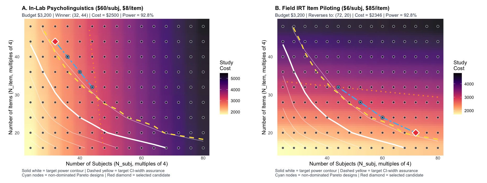

# glmmplanr — Two-Dimensional Sample Size and Precision Planning for Crossed Binary Designs and Explanatory Item Response Models

[](https://github.com/Ryuya-dot-com/glmmplanr/actions/workflows/R-CMD-check.yaml)
[](https://github.com/Ryuya-dot-com/glmmplanr/blob/main/LICENSE.md)
[](https://www.r-project.org/)
[](src/glmm_laplace.cpp)

`glmmplanr` is an end-to-end R package for planning **two-dimensional ($N_{\text{subj}} \times N_{\text{item}}$) sample sizes, estimation precision, and study budgets** in crossed binary Generalized Linear Mixed Models (GLMMs) and Explanatory Item Response Models (EIRMs).

Without requiring either a pre-fitted pilot model or custom data-generation loops, `glmmplanr` translates **declarative experimental/assessment schedules (Latin-square, incomplete-block, testlet) $\times$ substantive marginal percentage-point effects** directly into **verified Pareto-optimal and cost-optimal $(N_{\text{subj}}, N_{\text{item}})$ designs** with explicit Monte Carlo confidence bounds.

In studies where participants judge binary preferences (e.g., endorse = `1`, reject = `0`), set `chance = 0` to plan marginal endorsement differences across conditions. When each participant sees only a subset of an item bank, specify the total bank size via `n_item` and the number of distinct items presented per participant via `items_per_subject`. Cluster-randomized school interventions and longitudinal daily-diary designs require different correlation structures; see [Scope Across Research Designs](inst/validation-guide.md#cross-field-designs).

---

## Installation

```r
# Install from GitHub (requires a C++ compiler toolchain for RcppEigen)
# install.packages("remotes")
remotes::install_github("Ryuya-dot-com/glmmplanr")
```

After installation, inspect the bundled validation conditions and benchmarks via `vignette("validation-and-scope", package = "glmmplanr")` (or `system.file("validation-guide.md", package = "glmmplanr")`). Because detecting a condition contrast in crossed binary experiments, testing Rasch model misfit, and calibrating a fixed operational item bank answer distinct statistical questions, we summarize inputs, outputs, and scope across 19 related R packages in [Related R Packages by Research Goal](inst/validation-guide.md#related-packages).

---

## Visual Recipe Gallery & Interactive Explorer

Explore five complete domain case studies — **(1) Psycholinguistic $2 \times 2$ Latin-Square 3AFC Experiments**, **(2) Between-Subject Incomplete-Block Designs & Logistic Non-Collapsibility**, **(3) Testlet-Nested Reading Passages & Multi-Scenario Robustness**, **(4) Two-Dimensional Cost & Budget Allocation Reversal**, and **(5) Random-Item vs. Fixed-Item-Bank Rasch Calibration** — with publication-ready figures, copy-ready R scripts, and Registered Report justifications:

- **GitHub Visual Recipe Gallery**: [`inst/gallery/GALLERY.md`](inst/gallery/GALLERY.md)
- **Interactive HTML Explorer** (135-cell hover surface, live Gauss-Hermite non-collapsibility calculator, and real-time unit-cost / grant-budget sliders): [**Launch Online Demo**](https://ryuya-dot-com.github.io/glmmplanr/) or open locally from R via:
  ```r
  browseURL(system.file("gallery", "index.html", package = "glmmplanr"))
  ```



---

## Key Capabilities

1. **Declarative Crossed, Latin-Square, Incomplete-Block, and Testlet Schedules (`design_crossed()`, `design_testlet()`)**
   - Separates independent trial-level missingness (`attrition`) from whole-participant dropout (`participant_dropout`). `n_subj` denotes recruited participants, `n_subj_expected` denotes expected participants contributing at least one observation, and complete dropouts are retained in replication accounting.
   - Supports multi-item reading/listening passages (`design_testlet()`) and stress-testing against unmodeled reader-by-passage local dependence via `calibrate_dgp(participant_testlet_sd = ...)` on the conditional logit scale (default `0`; [Wang & Wilson, 2005](https://doi.org/10.1177/0146621604271053)).
   - Enforces list-balance multiplicity across the entire search lattice while distinguishing **scheduled trials (`n_trials_scheduled`)** from **expected post-attrition observations (`n_trials_expected`)**.
   - Partial item-bank presentation: for example, calling `generate_design_schedule(des, n_subj = 64, n_item = 20)` on `design_crossed(list(group = c("A", "B")), allocation = "between_subj", items_per_subject = 5, item_seed = 417)` schedules 320 trials in which each participant responds to 5 distinct items sampled without replacement from a 20-item bank. Replications share the planned schedule and generate missingness after assignment; vary `item_seed` to compare alternative schedules.
   - Factor-specific assignment via `between_subj` and `between_item` (printing a design displays within/between status on both subject and item sides).
   - Built-in factor codings: centered deviation `sum` (`-0.5` and `+0.5` for two-level factors; zero column means for multi-level factors), orthogonal unit-step `helmert`, and reference-level `treatment`. Automatic standardization to SD units and grand-/group-mean centering of continuous covariates are not performed.

2. **Exact Marginal Probability & $m$-AFC Guessing Calibration (`calibrate_dgp()`, `cell_probs_from_diffs()`)**
   - Numerically solves via 2D Gauss-Hermite quadrature for conditional GLMM fixed effects $\boldsymbol{\beta}$ that reproduce researcher-specified population-averaged cell probabilities in the presence of crossed random effects and lower guessing asymptotes ($g = 1/m$, e.g., `1/3` for 3AFC, `0.25` for 4AFC).
   - Use `check_dgp(dgp, plot = FALSE)$cell_diagnostics` to compare population-averaged `quad_prob` against zero-random-effect `conditional_prob` cell by cell ([Passing Calibrated Parameters to PowRPriori and Verifying in simr](inst/validation-guide.md#package-calibration)).

3. **Percentage-Point Power and Interval-Width Planning (`specify_target(scale = "pp")`)**
   - On `"pp"` and `"prob"` scales, a replication counts as a detection when the confidence/credible interval for the specified marginal or conditional cell contrast excludes zero (`effective_logit_power` reports the accompanying conditional-logit diagnostic; [Ai & Norton, 2003](https://doi.org/10.1016/S0165-1765(03)00032-6)).
   - In Stage-2 verification (`prob_se_method = "bootstrap"`, default), each fitted replication draws fresh subject, item, and testlet effects and responses, refits the analysis model on the observed schedule (using the zero-copy C++ kernel `cpp_prob_bootstrap_batch()` for C++ engines; default `prob_boot = 99`), and forms a normal-theory interval from the refitted contrast SD; replications with fewer than 90% valid refits are counted as estimation failures.
   - Stage-1 exploration, `prob_se_method = "joint_delta"`, and probability diagnostics attached to logit targets propagate both fixed-effect curvature and log variance-component uncertainty (including logistic non-collapsibility sensitivity) analytically via Gauss-Hermite derivatives. Stan engines compute the posterior mean and SD of the contrast across joint HMC draws ([Hedeker et al., 2018](https://doi.org/10.1111/biom.12707); [lme4::bootMer](https://lme4.github.io/lme4/reference/bootMer.html)).

4. **Stabilized C++ Estimation & Conservative Monte Carlo Decisions**
   - The built-in C++ engine (`cpp_laplace` / `bayes_laplace`) uses globally concave safeguarded PIRLS weights for forced-choice tasks (`chance > 0`) with Armijo backtracking, observed response-specific Laplace determinant/gradient corrections, and joint fixed-effect covariance matrices (`vcov`) combining Tierney-Kadane Laplace curvature with variance-component sensitivity.
   - Required $(N_{\text{subj}}, N_{\text{item}})$ for conditional-logit precision in 3AFC tasks depends on the planned estimator: across 40 paired $48 \times 32$ 3AFC datasets, joint Laplace mean SE is `0.227` logit (`40/40` coverage), whereas RStan HMC integrating over the right tail of half-Student-$t_3$ random-slope priors yields mean posterior SD `0.270` logit; in 192 independent confirmation datasets, both $72 \times 32$ and $48 \times 48$ pass with `192/192` width attainment and `94.8%` / `96.4%` coverage ([Estimator Width & Coverage Comparison](inst/validation-guide.md#three-choice-precision)).
   - Candidate recommendations require `decision_status == "pass"` (Wilson lower confidence bound $\ge$ target threshold; across multiple scenarios, the same design must pass every scenario). When `feasible = FALSE`, `optimal` marks an unconfirmed candidate for follow-up and `optimal_high_confidence` is empty.
   - `criterion = "both"` enforces separate thresholds on power (`power_min`) and width attainment (`ci_assurance`), whereas `criterion = "joint"` compares same-replication simultaneous detection and width attainment (`joint_prob`) against `power_min`.
   - Independent coverage benchmarks on $64 \times 20$ designs are documented in [Marginal Interval Coverage Recheck](inst/validation-guide.md#coverage-recheck). Because pointwise Wilson intervals do not guarantee simultaneous familywise coverage across an entire search, confirm final pre-registered designs at a fresh seed and prespecified `nsim` via `validate_design_point()`, which evaluates paired null (`detection` = Type I error) and planned (`detection` = power) operating characteristics ([Morris et al., 2019](https://doi.org/10.1002/sim.8086)).

5. **Pareto Frontiers, 2D Study Cost / Budget Optimization, and Multi-Scenario Robustness (`prefer`, `cost`, `budget`, `scenario_dgps()`, `switch_preference()`)**
   - Enumerates non-dominated **Pareto-optimal $(N_{\text{subj}}, N_{\text{item}})$ designs** and supports instant zero-resimulation rule switching via `prefer = c("balanced", "fewer_subj", "fewer_items", "fewer_trials", "min_cost")`.
   - Supplying `cost = c(subj = 60, item = 8, trial = 0.02, fixed = 200)` (or any custom cost function `function(n_subj, n_item, n_trials_scheduled)`) and an optional `budget` cap identifies the minimum-cost passing design within budget — or reports the cheapest passing fallback (`min_cost_over_budget`) when the budget is insufficient.
   - Quantifies exact sample-size and cost increments (`+delta_subj`, `+delta_item`, `+delta_cost`) required to move from a standard assumption (e.g., `+8 pp`) to an all-scenario robust plan (e.g., `+5 / +8 / +10 pp`).

6. **High-Throughput Parallel C++ Search & Live Progress / ETA (`glmm_laplace.cpp`, `early_stop`, `verbose`)**
   - Combines L1-contiguous `RowMajor` trial assembly, variance/correlation-decoupled SQUAREM acceleration, batch C++ parametric bootstrap, `mirai` non-forked daemon pools, Stage-2 futility stopping (`early_stop`), and live `cli` progress bars with elapsed time and ETA (`verbose = TRUE`).

---

## Simulating and Planning Rasch / 1PL Models

Specify a factor-free crossed person-by-item design with `list()`. Below is a 1-parameter logistic (Rasch) model with discrimination `1`, lower asymptote `0`, and random person and item intercepts drawn from normal populations (`cell_probs` is the marginal accuracy across future persons and items; SDs are on the conditional logit scale; [De Boeck, 2008](https://doi.org/10.1007/s11336-008-9092-x)):

```r
library(glmmplanr)

design <- design_crossed(list(), allocation = "crossed")
dgp <- calibrate_dgp(design, cell_probs = 0.65, chance = 0,
                     subj_sd = 0.8, item_sd = 0.6)
set.seed(415)
responses <- simulate_dgp_data(dgp, n_subj = 72, n_item = 24)
```

`specify_target(dgp, "(Intercept)", scale = "logit")` tests whether the fixed intercept equals `0` (50% accuracy at mean ability and mean item easiness). Plan precision for a single marginal accuracy rate with `scale = "prob", criterion = "ci_width"` and inspect fixed-size operating characteristics via `evaluate_design_point()` (use `scale = "logit"` when pairing null and planned intercepts in `validate_design_point()`, as probability `0` is not a finite logit null). Multilevel Rasch extensions with schools and classrooms are illustrated in [Rasch & Multilevel Recovery](inst/validation-guide.md#rasch-recovery).

### Sample Sizes for Ability, Difficulty, and Item-Bank Calibration

`plan_rasch_precision()` evaluates whether candidate $(N_{\text{subj}}, N_{\text{item}})$ designs simultaneously satisfy multiple recovery tolerances when new persons and items are sampled on each replication:

```r
designs <- data.frame(n_subj = c(144, 72, 144), n_item = c(12, 24, 24))
limits  <- c(ability = 0.50, difficulty = 0.30, item_sd = 0.20)

plan <- plan_rasch_precision(
  dgp, designs,
  max_error = limits,
  assurance = 0.80,
  nsim      = 64,
  engine    = "cpp_laplace",
  seed      = 518307
)
subset(plan$summary, target == "joint")
plan$pareto
```

`ability` and `difficulty` bound within-replication RMSE across all scheduled persons or items (`unobserved` units count as not meeting the bank-wide difficulty tolerance, and estimation failures remain in the denominator); `person_sd` / `item_sd` bound absolute SD errors (logit) and `person_variance` / `item_variance` bound variance errors ($\text{logit}^2$). See [Random-Item Rasch Benchmarks](inst/validation-guide.md#rasch-precision).

- To bound the **worst-case error across every individual item**, include `difficulty_max_abs_error` in `max_error`.
- To plan examinee sample sizes for calibrating a **fixed vector of operational item difficulties** across replications, use `plan_rasch_fixed_bank()` (`method = "fixed_item"` for Marginal Maximum Likelihood via built-in `"mml"` or `"tam"`, or `method = "random_item"` for Empirical Bayes shrinkage via `"cpp_laplace"` or `"lme4"`; see [Fixed 16-Item Bank Comparison with TAM](inst/validation-guide.md#rasch-fixed-bank)).

---

## Diagnosing Extreme Response Patterns

`response_patterns()` tabulates correct counts and observed trial counts per participant and item (include all scheduled IDs as factor levels to detect completely `unobserved` units; `NA` values are treated as missing):

```r
# `trials` can be output from simulate_dgp_data() or empirical trial-level data
patterns <- with(trials, response_patterns(y, subj, item))
subset(patterns, pattern %in% c("all_correct", "all_incorrect", "unobserved"))
```

`summary(plan_res)` reports how many replications exhibited `all_correct`, `all_incorrect`, or `unobserved` participants/items, how many of those replications yielded invalid target-scale estimates, and the maximum observed trial count among affected units.

---

## Quickstart: Percentage-Point Precision, Cost Optimization & Multi-Scenario Robustness

```r
library(glmmplanr)

# 1. Balanced 2x2 Latin-square design (4 lists, 5% random trial attrition)
des <- design_crossed(
  factors = list(
    exposure = c("incidental", "intentional"),
    spacing  = c("massed", "distributed")
  ),
  allocation = "latin_square",
  contrast   = "sum",
  attrition  = 0.05
)

# 2. Construct cell accuracies from substantive pp effects & invert 3AFC (g = 1/3) DGP
c_probs <- cell_probs_from_diffs(
  des,
  baseline_prob = 0.65,
  effects_pp    = c(exposure = 8, spacing = 6, "exposure:spacing" = 4)
)

dgp <- des |>
  calibrate_dgp(
    cell_probs      = c_probs,
    chance          = 1 / 3,
    subj_prob_range = c(0.42, 0.85),
    item_prob_range = c(0.45, 0.86),
    slope_sd_ratio  = 0.30,
    corr_structure  = 0.20
  )

# 3. Target both >= 80% power AND 95% CI width <= 12 pp on the marginal pp scale
spec <- dgp |>
  specify_target(
    effect         = "exposure",
    scale          = "pp",
    prob_estimand  = "marginal",
    criterion      = "both",
    power_min      = 0.80,
    ci_width       = 12,
    failure_policy = "effective",
    engine         = "bayes_laplace"
  )

# Optional: prespecified null + planned confirmation at a fixed candidate design
# validate_design_point(spec, n_subj = 48, n_item = 32, nsim = 200, seed = 74011)

# 4. Optimize across +5 / +8 / +10 pp scenarios with study cost & budget tracking
scens <- scenario_dgps(
  dgp,
  effect          = "exposure",
  effect_diffs_pp = c(diff_5pp = 5, diff_8pp = 8, diff_10pp = 10)
)

plan_res <- spec |>
  optimize_sample_size(
    n_subj_range      = c(24, 120),
    n_item_range      = c(16, 64),
    prefer            = "balanced",
    cost              = c(subj = 60, item = 8, trial = 0.02, fixed = 200),
    budget            = 4500,
    scenarios         = scens,
    standard_scenario = "diff_8pp",
    method            = "surrogate_gp",
    n_eval_init       = 16,
    nsim_final        = 1000,
    nsim_topup        = 500,
    workers           = 8,
    seed              = 20261119
  )

# Instantaneously switch preference rules or unit-cost regimes without re-simulating
switch_preference(plan_res, prefer = "min_cost")
switch_preference(plan_res, prefer = "fewer_items")

# 5. Publication tables, 2D contours / Pareto curves / 3D surfaces, and Methods text
summary(plan_res)
as_gt(plan_res)
plot(plan_res, type = "contour", metric = "prob_ci_width_pp")
plot(plan_res, type = "contour", metric = "cost")
plot(plan_res, type = "pareto")
plot(plan_res, type = "surface3d", metric = "power")
report_plan(plan_res, lang = "en")
```

---

## License & Disclaimer

`glmmplanr` is open-source software released under the **[MIT License](https://github.com/Ryuya-dot-com/glmmplanr/blob/main/LICENSE.md)** (Copyright © 2026 Ryuya Komuro).

You are completely free to use, copy, modify, merge, publish, and distribute this software for academic, educational, or commercial purposes. **However, the software is provided "AS IS", without warranty of any kind, express or implied.** Sample size, precision, and cost outputs depend on user-supplied data-generating assumptions, model specifications, and Monte Carlo tolerances; **users assume sole responsibility** for validating assumptions, interpreting simulation diagnostics, and making design, ethical, or financial decisions in their own research.
