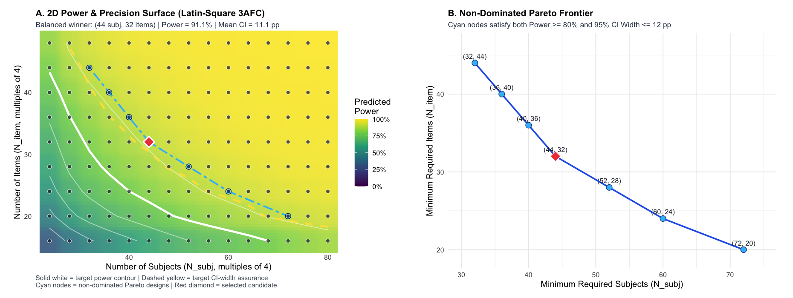
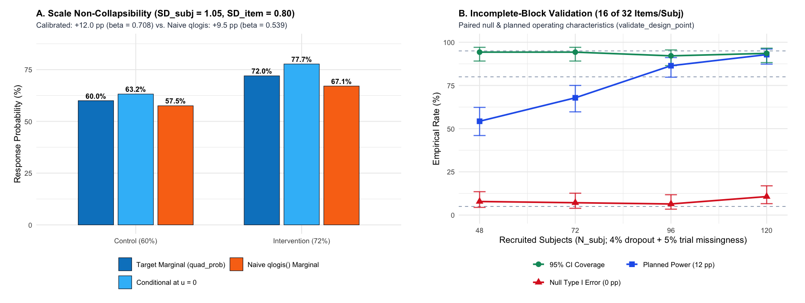
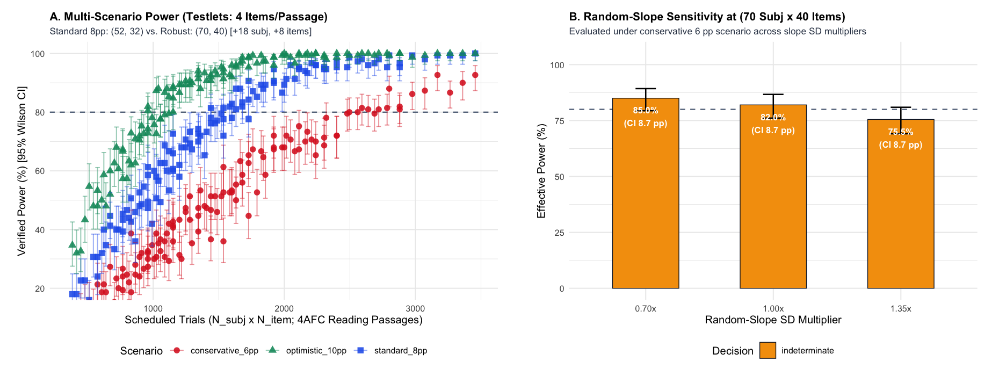
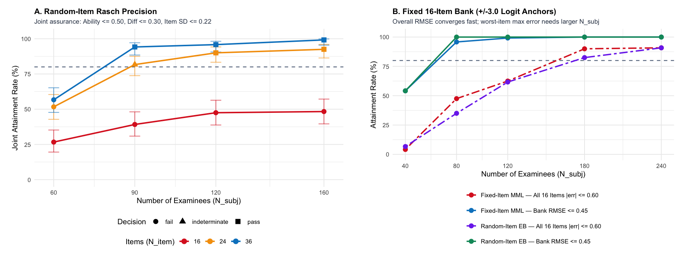

# `glmmplanr` Visual Recipe Gallery

An end-to-end showcase of **four domain-specific sample size and precision planning workflows** for crossed binary Generalized Linear Mixed Models (GLMMs) and Explanatory Item Response Models:

- **Interactive Browser Gallery**: Explore online at <https://ryuya-dot-com.github.io/glmmplanr/> or open [`index.html`](index.html) locally (`browseURL(system.file("gallery", "index.html", package = "glmmplanr"))`) for interactive 2D hover surfaces, instant Pareto trade-off switching, copy-ready R scripts, and Registered Report text generators.
- **Full Reproducibility**: Regenerate the figures and underlying simulation payload from scratch via [`build_gallery.R`](build_gallery.R) (`Rscript --vanilla inst/gallery/build_gallery.R`).

---

## Quick Recipe Navigator

| # | Research Domain | Core Design & Statistical Challenge | Key `glmmplanr` Functions | Recommended Plan |
|---|---|---|---|---|
| [1](#recipe-1-psycholinguistics--balanced-2x2-latin-square-3afc-experiment) | **Psycholinguistics** | Counterbalanced $2 \times 2$ Latin-square, 3AFC guessing floor ($g = 1/3$), simultaneous power $\ge 80\%$ and 95% CI width $\le 12\text{ pp}$ | `design_crossed()`, `cell_probs_from_diffs()`, `calibrate_dgp()`, `specify_target()`, `optimize_sample_size()`, `switch_preference()` | **44 subjects $\times$ 32 items** (Power 91.1%, Mean CI 11.06 pp) |
| [2](#recipe-2-behavioral-experiments--between-subject-incomplete-block--scale-calibration) | **Behavioral Experiments** | Two-arm intervention, 50% incomplete-block item sampling (16 of 32 items/participant), dropout + attrition, logistic non-collapsibility | `design_crossed(items_per_subject = 16)`, `check_dgp()`, `validate_design_point()` | **96 subjects $\times$ 32-item bank** (Power 86.4%, Null Type I 6.4%) |
| [3](#recipe-3-reading-comprehension--explanatory-irt--testlet-nested-passages--multi-scenario-robustness) | **Reading & Explanatory IRT** | 4 comprehension items nested per passage (`testlet`), 4AFC ($g = 0.25$), reader-by-passage local dependence, 6 / 8 / 10 pp multi-scenario robustness | `design_testlet()`, `scenario_dgps()`, `report_plan()` | Standard (8 pp): **52 $\times$ 32**<br>All-scenario robust: **70 $\times$ 40** (`+18` subj, `+8` items) |
| [4](#recipe-4-psychometrics--language-assessment--random-item-vs-fixed-item-bank-rasch-calibration) | **Psychometrics & Assessment** | Random-item generalization vs. calibrating a fixed 16-item anchor bank containing extreme $\pm 3.0$ logit items | `plan_rasch_precision()`, `plan_rasch_fixed_bank()` | Random-item: **120 $\times$ 24** or **90 $\times$ 36**<br>Fixed bank (all 16 items $\le 0.60$): **180 examinees** (MML) |

---

<a id="recipe-1-psycholinguistics--balanced-2x2-latin-square-3afc-experiment"></a>

## Recipe 1: Psycholinguistics — Balanced $2 \times 2$ Latin-Square 3AFC Experiment

### Why Generic Simulators Struggle Here
In psycholinguistic and memory studies (e.g., incidental vs. intentional vocabulary learning crossed with massed vs. distributed spacing), participants and target words are crossed via **4 counterbalanced Latin-square lists**, responses have a **3-alternative forced-choice (3AFC) lower guessing asymptote ($g = 1/3$)**, and reviewers increasingly demand **Accuracy in Parameter Estimation (AIPE)** alongside hypothesis testing. Standard GLMM power tools assume $g = 0$, require pre-fitted pilot models or raw conditional logits, and scan only one sample-size axis at a time.

### Complete R Workflow

```r
library(glmmplanr)

# 1. Declare a 2x2 counterbalanced Latin-square design (enforces multiples of 4 x 4)
des1 <- design_crossed(
  factors = list(
    exposure = c("incidental", "intentional"),
    spacing  = c("massed", "distributed")
  ),
  allocation = "latin_square",
  contrast   = "sum",
  attrition  = 0.05
)

# 2. Specify substantive marginal percentage-point effects & invert 3AFC (g = 1/3) DGP
probs1 <- cell_probs_from_diffs(
  des1,
  baseline_prob = 0.64,
  effects_pp    = c(exposure = 9, spacing = 5, "exposure:spacing" = 3)
)
dgp1 <- calibrate_dgp(
  des1,
  cell_probs      = probs1,
  chance          = 1 / 3,
  subj_prob_range = c(0.45, 0.84),
  item_prob_range = c(0.46, 0.85),
  slope_sd_ratio  = 0.25,
  corr_structure  = 0.15
)

# 3. Target both >= 80% power AND 95% CI width <= 12 pp on the marginal pp scale
spec1 <- specify_target(
  dgp1,
  effect         = "exposure",
  scale          = "pp",
  prob_estimand  = "marginal",
  criterion      = "both",
  power_min      = 0.80,
  ci_width       = 12.0,
  prob_se_method = "joint_delta",
  engine         = "bayes_laplace"
)

# 4. Optimize across (N_subj x N_item) and extract the verified Pareto frontier
res1 <- optimize_sample_size(
  spec1,
  n_subj_range = c(24, 80),
  n_item_range = c(16, 48),
  prefer       = "balanced",
  method       = "grid",
  nsim_final   = 180,
  workers      = 4,
  seed         = 810101
)

plot(res1, type = "contour", metric = "power")
plot(res1, type = "pareto")
```

### Visual Output & Interpretation



- **Panel A (2D Surface)**: Notice how the **dashed yellow CI-width assurance contour** ($\le 12\text{ pp}$ in $\ge 80\%$ of replications) lies *above and to the right* of the **solid white 80% power contour**. Planning for power alone would select an under-precise design (e.g., $48 \times 20$ achieves $81.1\%$ power, but its 95% CI width meets $\le 12\text{ pp}$ in only $1.1\%$ of studies!).
- **Panel B (Pareto Frontier)**: Seven non-dominated designs simultaneously pass both Wilson lower-bound gates: `(72, 20)`, `(60, 24)`, `(52, 28)`, **`(44, 32)`** (balanced recommendation: `1,408` scheduled trials, Power = `91.1% [86.0%, 94.5%]`, Mean CI = `11.06 pp`, Singular rate = `0.0%`), `(40, 36)`, `(36, 40)`, and `(32, 44)`.

---

<a id="recipe-2-behavioral-experiments--between-subject-incomplete-block--scale-calibration"></a>

## Recipe 2: Behavioral Experiments — Between-Subject Incomplete-Block & Scale Calibration

### Why Generic Simulators Struggle Here
When random intercepts are substantial ($\text{SD}_{\text{subj}} = 1.05$, $\text{SD}_{\text{item}} = 0.80$), **logistic non-collapsibility** pulls population-averaged (marginal) probabilities toward $50\%$. Plugging `qlogis(c(0.60, 0.72))` directly into a GLMM simulator (`beta = 0.539`) silently shrinks the true population-averaged treatment effect from **+12.0 pp down to +9.5 pp**, distorting sample size calculations before a single dataset is simulated. In addition, participants often complete only a **random subset of an item bank** (`items_per_subject = 16` of `32` items) with both participant dropout (`4%`) and trial missingness (`5%`).

### Complete R Workflow

```r
# 1. Two-arm between-subject design with 50% incomplete-block presentation & dropout
des2 <- design_crossed(
  factors             = list(arm = c("control", "intervention")),
  allocation          = "between_subj",
  between_subj        = "arm",
  contrast            = "treatment",
  items_per_subject   = 16L,   # Each participant sees 16 items drawn from a 32-item bank
  attrition           = 0.05,  # 5% random trial missingness
  participant_dropout = 0.04,  # 4% whole-participant dropout
  item_seed           = 402L
)

# 2. Invert marginal 60% vs. 72% (+12 pp) under crossed random intercepts
dgp2 <- calibrate_dgp(
  des2,
  cell_probs     = c(control = 0.60, intervention = 0.72),
  chance         = 0,
  subj_sd        = 1.05,
  item_sd        = 0.80,
  slope_sd_ratio = 0,
  corr_structure = 0
)
check_dgp(dgp2, plot = FALSE)$cell_diagnostics

# 3. Pre-registration validation under paired H0 (0 pp) and H1 (+12 pp)
spec2 <- specify_target(
  dgp2, effect = "arm", scale = "pp", prob_estimand = "marginal",
  criterion = "power", power_min = 0.80, prob_se_method = "joint_delta"
)
validate_design_point(spec2, n_subj = 96, n_item = 32, nsim = 140, seed = 820030)
```

### Visual Output & Interpretation



- **Panel A (Scale Non-Collapsibility)**: To achieve a true marginal **60.0% vs. 72.0%** (+12.0 pp) effect across future participants and items, `calibrate_dgp()` solves for conditional $\beta = 0.708$ (corresponding to $63.2\%$ vs. $77.7\%$ at $\mathbf{u} = \mathbf{0}$). Naive logit transformation ($\beta = 0.539$) yields only $57.5\%$ vs. $67.1\%$ (+9.5 pp).
- **Panel B (Paired Null & Planned Validation)**: `validate_design_point()` evaluates disjoint RNG substreams under both $H_0$ (`0 pp`) and $H_1$ (`+12 pp`). At **96 recruited participants** (48 per arm $\times$ 16 scheduled items = 1,536 scheduled trials, accounting for 4% dropout and 5% trial missingness), empirical power reaches **86.4% [79.8%, 91.1%]** while maintaining 95% CI coverage at **92.1%** and null Type I error at **6.4%**.

---

<a id="recipe-3-reading-comprehension--explanatory-irt--testlet-nested-passages--multi-scenario-robustness"></a>

## Recipe 3: Reading Comprehension & Explanatory IRT — Testlet-Nested Passages & Multi-Scenario Robustness

### Why Generic Simulators Struggle Here
In reading comprehension, listening assessment, and vignette experiments, multiple items share a common stimulus passage (**testlet structure**, Wang & Wilson, 2005). Ignoring passage-level clustering and reader-by-passage local dependence (`participant_testlet_sd`) understates standard errors. Furthermore, when true effect sizes are uncertain (e.g., marginal glossing may improve 4AFC comprehension by **+6, +8, or +10 pp**), researchers need the exact **sample-size increment** required to protect against conservative scenarios.

### Complete R Workflow

```r
# 1. Testlet design: 4 comprehension items nested per reading passage (4AFC, g = 0.25)
des3 <- design_testlet(
  factors      = list(glossing = c("none", "marginal_gloss")),
  testlet_size = 4L,
  contrast     = "sum",
  attrition    = 0.03
)

probs3 <- cell_probs_from_diffs(des3, baseline_prob = 0.66, effects_pp = c(glossing = 8))
dgp3 <- calibrate_dgp(
  des3,
  cell_probs             = probs3,
  chance                 = 0.25,
  subj_sd                = 0.75,
  item_sd                = 0.50,
  testlet_sd             = 0.45,
  participant_testlet_sd = 0.30, # Reader-by-passage local dependence stress test
  slope_sd_ratio         = 0.20,
  corr_structure         = 0.10
)

# 2. Multi-scenario robustness across +6 pp, +8 pp (standard), and +10 pp
spec3 <- specify_target(
  dgp3, effect = "glossing", scale = "pp", criterion = "power",
  power_min = 0.80, prob_se_method = "joint_delta"
)
scens3 <- scenario_dgps(
  dgp3, effect = "glossing",
  effect_diffs_pp = c(conservative_6pp = 6, standard_8pp = 8, optimistic_10pp = 10)
)

res3 <- optimize_sample_size(
  spec3,
  n_subj_range      = c(24, 72),
  n_item_range      = c(16, 48), # Automatically snapped to balanced passage multiples (8 items = 2 passages)
  scenarios         = scens3,
  standard_scenario = "standard_8pp",
  method            = "grid",
  nsim_final        = 150,
  workers           = 4,
  seed              = 830303
)

cat(report_plan(res3, lang = "en"))
```

### Visual Output & Interpretation



- **Panel A (Multi-Scenario Robustness Increment)**: Satisfying the standard **+8 pp** assumption requires **52 readers $\times$ 32 items** (8 passages, `1,664` scheduled trials). Guaranteeing `PASS` across *all three* scenarios down to **+6 pp** requires **70 readers $\times$ 40 items** (10 passages, `2,800` trials) — an explicit robustness increment of **`+18` participants and `+8` items** (`+2` passages).
- **Panel B (Random-Slope Sensitivity)**: At `(70, 40)` under the conservative +6 pp effect, `optimize_sample_size()` automatically checks $0.70\times$, $1.00\times$, and $1.35\times$ random-slope SD multipliers (`85.0%`, `82.0%`, and `75.5%` power), warning researchers if steeper individual-difference slopes could erode conservative power.

---

<a id="recipe-4-psychometrics--language-assessment--random-item-vs-fixed-item-bank-rasch-calibration"></a>

## Recipe 4: Psychometrics & Language Assessment — Random-Item vs. Fixed-Item-Bank Rasch Calibration

### Why Generic Simulators Struggle Here
Psychometric sample size planning depends critically on **which items you generalize to** and **whether accuracy is defined on average or per item**:
1. **Random-Item Rasch (`plan_rasch_precision()`)**: Both examinees and items are sampled anew in each replication; precision requires recovering ability, item difficulties, *and* the population item SD ($\sigma_{\text{item}}$).
2. **Fixed-Item-Bank Calibration (`plan_rasch_fixed_bank()`)**: The same 16 operational anchor items — including two extreme items at $\pm 3.0\text{ logits}$ — are calibrated repeatedly. Bank-wide RMSE can look excellent while extreme anchor items suffer zero-correct trials or shrinkage bias!

### Complete R Workflow

```r
# Part A: Random-item Rasch precision (generalizing to new examinees & new items)
des5 <- design_crossed(list(), allocation = "crossed")
dgp5 <- calibrate_dgp(des5, cell_probs = 0.65, chance = 0, subj_sd = 0.85, item_sd = 0.65)

rasch_rand5 <- plan_rasch_precision(
  dgp5,
  designs   = expand.grid(n_subj = c(60, 90, 120, 160), n_item = c(16, 24, 36)),
  max_error = c(ability = 0.50, difficulty = 0.30, item_sd = 0.22),
  assurance = 0.80,
  nsim      = 120,
  engine    = "cpp_laplace",
  workers   = 4,
  seed      = 850501
)

# Part B: Fixed 16-item bank with two +/-3.0 logit anchors (MML vs. Random-Item EB)
b_bank5 <- c(-3.0, seq(-1.1, 1.1, length.out = 14), 3.0)

bank_mml5 <- plan_rasch_fixed_bank(
  item_difficulties = b_bank5,
  n_subj            = c(40, 80, 120, 180, 240),
  person_sd         = 0.85,
  max_error         = c(difficulty = 0.45, difficulty_max_abs_error = 0.60),
  method            = "fixed_item",
  engine            = "mml",
  assurance         = 0.80,
  nsim              = 120,
  workers           = 4,
  seed              = 850502
)
```

### Visual Output & Interpretation



- **Panel A (Random-Item Generalization)**: With only **16 items** (red curve), joint attainment plateaus below **49%** even at 160 examinees because 16 items cannot pin down $\sigma_{\text{item}}$ within $\pm 0.22\text{ logit}$. Increasing the item sample to **24 items** passes at **120 examinees** (`90.0% [83.3%, 94.2%]`), and **36 items** passes at **90 examinees** (`94.2% [88.4%, 97.1%]`).
- **Panel B (Fixed 16-Item Bank with $\pm 3.0$ Logit Anchors)**:
  - **Bank-wide RMSE $\le 0.45$** (solid lines) passes already at **80 examinees** (`95.8%` Fixed-Item MML; `100.0%` Random-Item EB).
  - **Worst-item max absolute error $\le 0.60$ across all 16 items** (dashed lines) is far stricter: at $N = 40$, $14/120$ replications produce all-correct or all-incorrect extreme anchor items (`4.2%` attainment). Fixed-Item MML passes at **180 examinees** (`90.0% [83.3%, 94.2%]`), whereas Random-Item Empirical Bayes pulls the $\pm 3.0\text{ logit}$ anchors toward the bank mean and requires **240 examinees** (`90.8%`) to clear the 80% Wilson lower bound.
